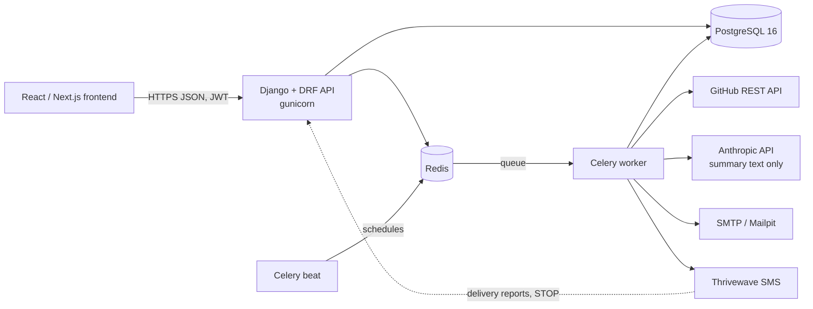
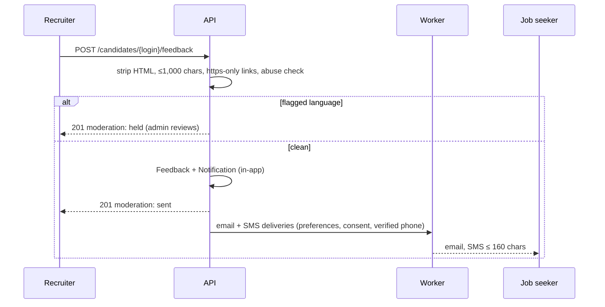

# Architecture



| Component | Why it exists |
| --- | --- |
| Django + DRF | Mature auth, ORM, admin and validation; the team can explain every piece |
| PostgreSQL | Real constraints (partial unique indexes, check constraints, case-insensitive uniqueness) that keep the data honest; tests run on it too |
| Redis | Celery broker and the cache behind rate limits |
| Celery worker | GitHub analyses take 10–60 s and SMTP/SMS can be slow; none of that may hold an HTTP request open |
| Celery beat | Weekly profile-view digest (Monday 08:00 Nairobi) and daily data retention |
| GitHub API | The only evidence source: public repos, commits, trees, manifests |
| Anthropic API | Writes three sentences of prose about numbers the rules already produced; checked and replaceable by a template |
| SMTP / Thrivewave | Email and SMS delivery of results and recruiter feedback; every attempt logged |

## Apps

| App | Owns |
| --- | --- |
| `core` | Base models (timestamps, public UUIDs), audit log, error format, pagination, request id, health, retention |
| `accounts` | User (email login, roles), profiles, consents, JWT, email/phone verification, GitHub OAuth, export/deletion |
| `companies` | Companies, recruiter profiles, approval workflow |
| `skills` | Skill catalogue, aliases, dependency → skill mappings (admin-editable) |
| `analysis` | GitHub client, pure scoring rules, pipeline, analyses, cards, claimed skills |
| `notifications` | Inbox, preferences, deliveries, email + Thrivewave providers, webhooks, digest |
| `recruiting` | Candidate search, job postings + match score, shortlists, feedback, profile views |
| `adminpanel` | Admin-only API, `seed_demo`, `warm_demo` |

## Request flow: running an analysis

```mermaid
sequenceDiagram
    participant FE as Frontend
    participant API
    participant DB as PostgreSQL
    participant W as Worker
    participant GH as GitHub
    FE->>API: POST /analyses
    API->>DB: Analysis(queued); one active per login (constraint)
    API-->>FE: 202 {id, status: queued}
    API->>W: run_analysis(id) after commit
    W->>GH: profile, repos, commits, trees, manifests (ETag cached, 5 in parallel)
    W->>W: detect skills → evidence → sub-scores → flags → claims → tips (pure)
    W->>W: summary (LLM, grounding check) or template
    W->>DB: evidence rows, scores, card; status completed
    W->>DB: Notification + Deliveries → email/SMS tasks
    loop every 2–3 s
        FE->>API: GET /analyses/{id}
        API-->>FE: status, progressStep 1–4, card when completed
    end
```

## Request flow: recruiter feedback



## Design rules that run through the code

1. **Every number is a rule.** Scoring modules are pure Python (`apps/analysis/services/`), unit
   tested at 100%, and documented in `SCORING.md`. The model only writes prose.
2. **One way to do each thing:** `notify()` for every message, `audit.record()` for every
   sensitive action, one error shape `{code, message, fields}` for every failure.
3. **Fail soft at the edges.** No LLM key → template summary. No Thrivewave docs → dry run. GitHub
   down → a clear `errorCode` on the analysis. The demo keeps working.
4. **Database constraints back up the code** (one active analysis per login, case-insensitive
   emails, score ranges, unique shortlist entries), so races can't create bad data.
