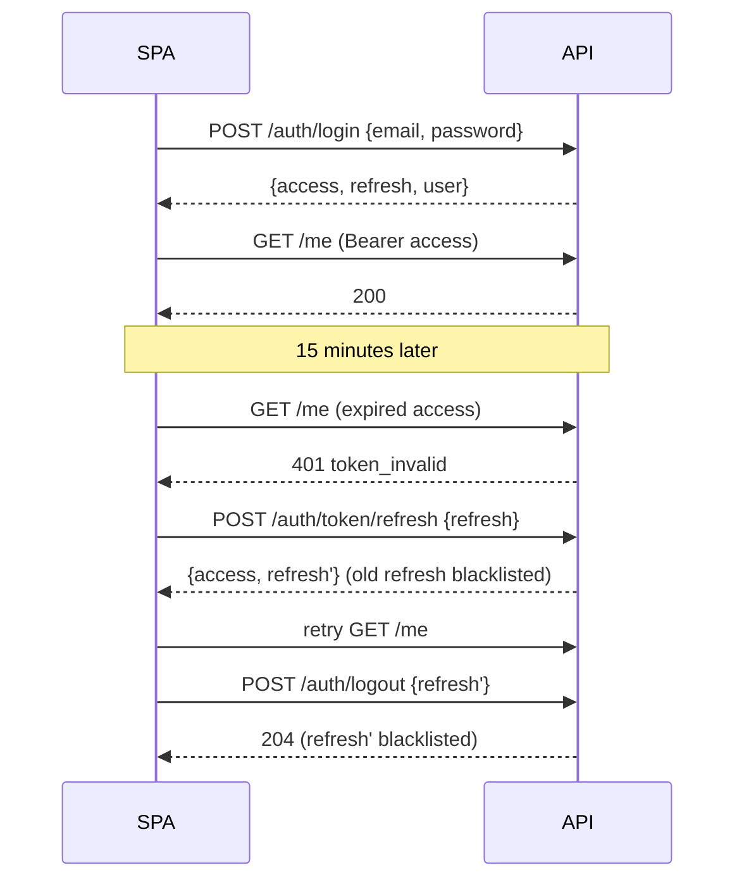
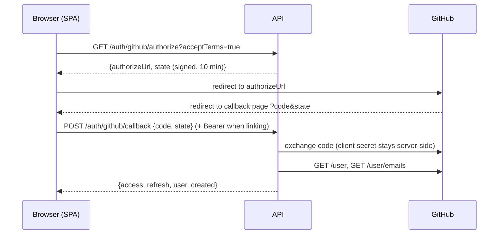

# Authentication and roles

## Tokens (JWT, djangorestframework-simplejwt)

| Token | Lifetime | Where the SPA keeps it | Notes |
| --- | --- | --- | --- |
| Access | 15 min (`JWT_ACCESS_MINUTES`) | Memory only | Sent as `Authorization: Bearer <access>` |
| Refresh | 7 days (`JWT_REFRESH_DAYS`) | `localStorage` (hackathon trade-off) | Rotates on every use; the old one is blacklisted |

Access-token claims: `user_id` (the user's **public UUID**, never the internal id), `role`,
`approvalStatus` (recruiters), `githubLogin` (if linked). Claims are rebuilt from the database on
every refresh, so an approval or role change reaches the frontend within 15 minutes.

Register, login and the GitHub callback all return `{ "access", "refresh", "user": Me }`.

**Signing out everywhere:** password change, password reset and (Phase 6) suspension blacklist
every outstanding refresh token. Access tokens already issued expire within 15 minutes.

**Cookie alternative (not built):** keeping the refresh token in an `httpOnly; Secure; SameSite`
cookie removes it from JavaScript's reach (XSS can't steal it), at the cost of CSRF handling and
`CORS_ALLOW_CREDENTIALS`. The setting `JWT_REFRESH_IN_COOKIE` is reserved for it.

## Email and password

- `POST /auth/register`: job seeker or recruiter (admins are created with `createsuperuser`).
  Requires `consents.terms`; a phone is required if `consents.smsFeedback` is true. Sends a
  verification link to `FRONTEND_URL/verify-email?token=…` (valid 3 days, bound to the address).
- Unverified users can sign in. From Phase 3, job seekers can't run analyses and recruiters can't
  be approved until verified (`email_not_verified`).
- Password reset: `POST /auth/password/reset` always answers 204 (no account enumeration). The link
  `FRONTEND_URL/reset-password?token=…` works **once** and for **1 hour**.
- Phone: `POST /auth/phone/send-code` (3/hour) then `POST /auth/phone/verify`. Codes are 6 digits,
  valid 10 minutes, 5 attempts, stored only as an HMAC. SMS is dry-run until Thrivewave is wired up
  (Phase 4); in local development the response includes `devCode`.

## Sign in with GitHub (OAuth web flow)

How the callback resolves the GitHub identity:

1. Known `github_id` → sign that user in (login, avatar and token refreshed).
2. Caller sent a valid JWT → link GitHub to that user (`409 github_already_linked` if it belongs to
   someone else or they already have a different one).
3. A user with the same **verified primary** GitHub email exists → link and sign in. If that
   account's email was never verified here, its password is removed first: someone may have
   pre-registered the address, and GitHub has just proven who really owns it.
4. Otherwise create a **job seeker** with a verified email. This needs `acceptTerms=true` on the
   authorize call (`terms_required`). Recruiters register by email and link GitHub afterwards
   (`recruiter_signup_requires_email`).

The GitHub token is stored encrypted (Fernet, `FIELD_ENCRYPTION_KEY`). It lifts the GitHub API limit
for the user's analyses from 60 to 5,000 requests/hour. `DELETE /auth/github` unlinks, refused for
accounts without a password (`password_required`) so nobody locks themselves out.

**CSRF on the OAuth flow:** the SPA must keep `state` in `sessionStorage` before redirecting and
compare it with the `state` GitHub returns. The dev page below does the same with a cookie.

### Setting up the GitHub OAuth app

GitHub → Settings → Developer settings → OAuth Apps → New OAuth App. One app per environment,
because GitHub allows one callback URL per app.

| Environment | Homepage URL | Authorization callback URL | `GITHUB_OAUTH_REDIRECT_URI` |
| --- | --- | --- | --- |
| Local, no frontend (now) | `http://localhost:8000` | `http://localhost:8000/api/v1/auth/github/dev-callback` | same as callback |
| Local, with frontend | `http://localhost:3000` | `http://localhost:3000/auth/github/callback` | same as callback |
| Production | `https://<frontend>` | `https://<frontend>/auth/github/callback` | same as callback |

Put `GITHUB_OAUTH_CLIENT_ID` and `GITHUB_OAUTH_CLIENT_SECRET` in `backend/.env` (never in git).

### Dev sign-in page (no frontend yet)

With dev settings, open **http://localhost:8000/api/v1/auth/github/dev-login** (add
`?role=recruiter` to test the recruiter refusal). After GitHub, the dev callback page posts the code
to the real callback endpoint and shows the tokens; paste the access token into Swagger's
**Authorize** button. To test linking, paste an existing account's access token into the page's
box and retry. Both pages answer 404 in production settings.

## Roles and permissions

| Class | Allows |
| --- | --- |
| `IsJobSeeker` | role `job_seeker` |
| `IsApprovedRecruiter` | role `recruiter` with status `approved`; other recruiters get `403 recruiter_not_approved` |
| `IsAdminRole` | role `admin` |
| `IsApprovedRecruiterOrAdmin` | either of the above |
| `IsOwnerOrAdmin` | object belongs to the user (`owner_field`, default `user`) or user is admin |

The full role × capability matrix is in the brief (section 4) and is enforced endpoint by endpoint
as each phase adds them.

## Recruiter approval

Recruiters register as `pending`. An admin approves, rejects or suspends them (Django admin bulk
actions now; admin API in Phase 6). Approval requires a verified email. Every change records the
reviewer, time and note, and is audit-logged; from Phase 4 the recruiter is notified by email.
