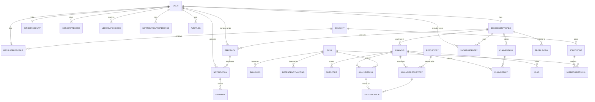

# Database

PostgreSQL 16, normalised to 3NF. Every table has a BigAutoField `id` (internal, for joins) and
`created_at`/`updated_at`; tables addressed in URLs also have a `public_id` UUID, which is all the
API ever exposes. Enumerations are `TextChoices` backed by `CHECK` constraints; numeric ranges
(sub-scores 0–20, Signal Score 0–100, evidence ≥ 0, weights 1–3, attempts ≤ 5) have `CHECK`s too.

## Tables

| Table | Why it exists | Key constraints and indexes |
| --- | --- | --- |
| `accounts_user` | One login for all roles | email unique + `UNIQUE(lower(email))`; phone unique when not null; role check; index on role |
| `accounts_jobseekerprofile` | Job-seeker-only fields (card visibility, open to work) | 1:1 user |
| `accounts_githubaccount` | GitHub identity proven by OAuth; source of `verifiedOwner`; encrypted token | github_id unique; login unique (lowercase) |
| `accounts_consentrecord` | Append-only consent history (DPA) | type check; index (user, type, -created) |
| `accounts_verificationcode` | SMS codes as HMAC with expiry and attempts | purpose check; attempts 0–5 |
| `companies_company` | Recruiters' employers | `UNIQUE(lower(name))` |
| `companies_recruiterprofile` | Recruiter fields and approval workflow | 1:1 user; status check; index on status |
| `skills_skill` | Catalogue | name, slug unique; category check |
| `skills_skillalias` | Other names ("js", GitHub's "Jupyter Notebook") | alias unique (lowercase) |
| `skills_dependencymapping` | Manifest package → skill, editable without deploys | unique (ecosystem, package); ecosystem check |
| `analysis_repository` | Public repo, shared across analyses | github_id unique |
| `analysis_analysis` | One run: status, progress, score, summary | index (login, -created), (status); **partial unique (login) where queued/running**; score 0–100 |
| `analysis_subscore` | The five sub-scores with reasons | unique (analysis, key); value 0–20 |
| `analysis_analysisrepository` | Evidence row per repo (commits, dates, tests, CI) | unique (analysis, repo) |
| `analysis_analysisskill` | Skill, evidence and label per analysis | unique (analysis, skill); evidence ≥ 0; index (skill, label) for search |
| `analysis_skillevidence` | Which repos prove which skill | unique pair |
| `analysis_claimedskill` | CV claims (max 12) | `UNIQUE(job_seeker, lower(raw_text))` |
| `analysis_claimresult` | Claim status per analysis | unique (analysis, claim) |
| `analysis_flag` | Noise flags (repo or claim) | type check |
| `analysis_githubcache` | Raw GitHub JSON + ETag (JSONB) | url unique; 7-day retention |
| `recruiting_jobposting` | Jobs | status/type/remote checks; index (status, -created) |
| `recruiting_jobrequiredskill` | Required skill, minimum label, weight | unique (job, skill); weight 1–3 |
| `recruiting_shortlistentry` | Recruiter's private pipeline | unique (recruiter, seeker, job) + partial unique when job is null |
| `recruiting_feedback` | Recruiter → job seeker messages, moderation | index (seeker, -created), (moderation) |
| `recruiting_profileview` | Recruiter views (counts only for job seekers) | index (seeker, -viewed) |
| `notifications_notification` | In-app inbox | index (user, read_at, -created) |
| `notifications_notificationpreference` | kind × channel switches | unique (user, kind, channel) |
| `notifications_delivery` | Every email/SMS attempt and provider reply (JSONB) | index (status), (provider_message_id) |
| `core_auditlog` | Append-only record of sensitive actions (JSONB metadata) | index (actor, -created), (action) |

## Normalisation notes

- **Sub-scores, skills, evidence and flags are rows, not a JSON blob**, because recruiters filter by
  skill and label (indexed `EXISTS` queries), history compares sub-scores across analyses, and
  every number on a card points back to the repos that produced it.
- **JSONB is used only where nothing is queried:** raw GitHub responses, provider responses and
  rendered messages, audit metadata, and the short `tips` text list.
- **Snapshots on purpose:** `Analysis.github_name/avatar_url` (the card shows the profile as it was)
  and `Feedback.company_name` (feedback still reads correctly after a recruiter changes company or
  deletes their account). These are point-in-time facts, not duplicated live state.
